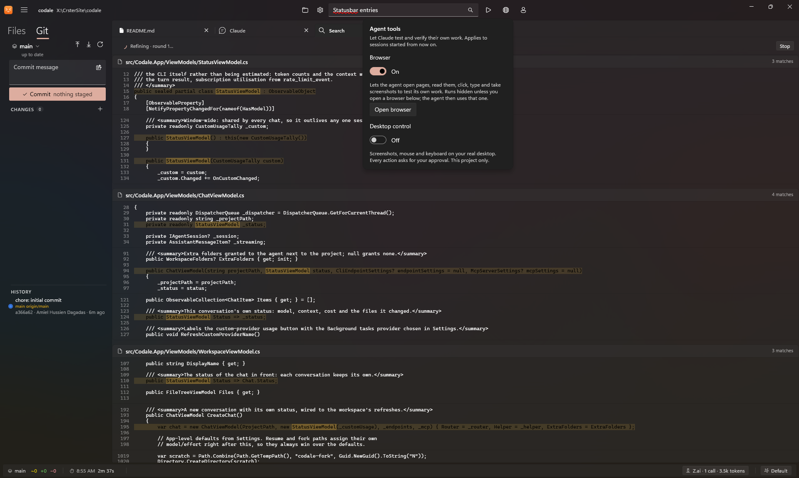
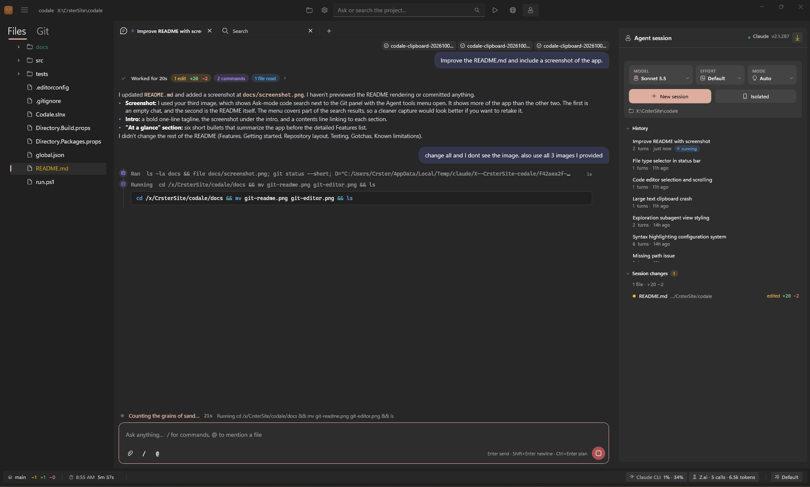
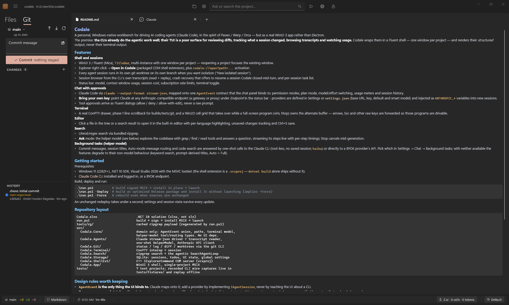
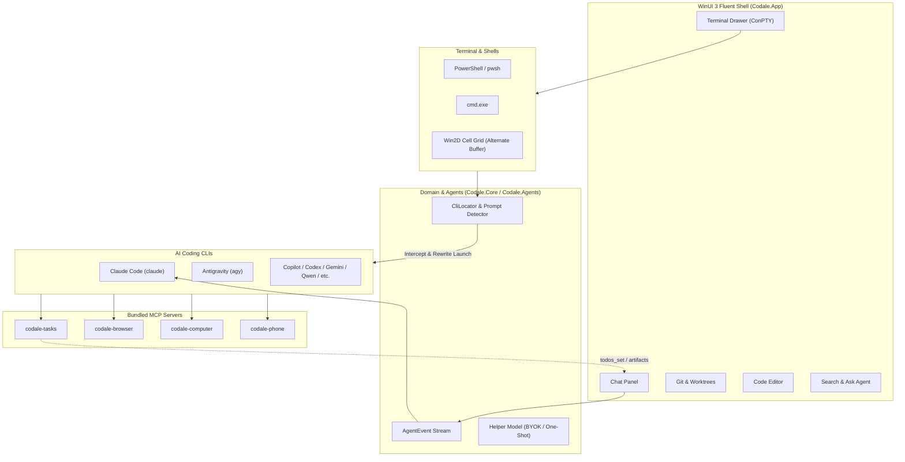

# Codale

**A Windows-native workbench for driving AI coding agents.**

Codale is a high-performance WinUI 3 desktop application (built with C# and .NET 10, not Electron) crafted around AI coding agents—in the spirit of modern developer power tools like Paseo, Warp, and Orca.

Modern AI coding CLIs are formidable agents, but standard terminal TUIs are a poor medium for reviewing multi-file diffs, tracking progress tasks, exploring transcripts, managing long-running background tasks, and watching token economics. Codale wraps them in a fluent Windows 11 shell with one dedicated window per project, rendering their **structured data** rather than raw terminal output, while providing a hardware-accelerated pseudoconsole (ConPTY) terminal drawer, native Git integration, a fast built-in code editor, and built-in Model Context Protocol (MCP) servers.

---



---

## Contents

- [Overview & Philosophy](#overview--philosophy)
- [Tour of the Workbench](#tour-of-the-workbench)
  - [Agent Chat & Session Management](#agent-chat--session-management)
  - [Integrated ConPTY Terminal Drawer](#integrated-conpty-terminal-drawer)
  - [Supported AI Coding Agent CLIs in Terminal](#supported-ai-coding-agent-clis-in-terminal)
  - [Built-in Model Context Protocol (MCP) Servers](#built-in-model-context-protocol-mcp-servers)
  - [Helper Model](#helper-model)
  - [Git Panel & Worktree Isolation](#git-panel--worktree-isolation)
  - [Fast Code Editor & Syntax Highlighting](#fast-code-editor--syntax-highlighting)
  - [Search & Autonomous Ask Mode](#search--autonomous-ask-mode)
- [Repository Layout](#repository-layout)
- [Architecture & Design Principles](#architecture--design-principles)
- [Configuration & Settings](#configuration--settings)
- [Getting Started & Build Guide](#getting-started--build-guide)
- [Testing & Quality Assurance](#testing--quality-assurance)
- [Gotchas & Troubleshooting](#gotchas--troubleshooting)
- [Known Limitations & Roadmap](#known-limitations--roadmap)

---

## Overview & Philosophy

1. **Windows-Native Performance**: Codale uses WinUI 3 (Windows App SDK) and .NET 10 with Mica material, acrylic accents, and native Windows 11 window chrome. No Chromium/Electron overhead for the shell itself.
2. **One Window Per Project**: Each project opens in its own window. Reopening an already open project focuses that window immediately. Windows Explorer integration allows right-clicking any folder and selecting **Open in Codale** via a native packaged C++ COM shell extension.
3. **Structured Agent Protocols**: Codale does not scrape terminal screens for the primary agent conversation. It drives CLI agents via structured streams (such as `claude --output-format stream-json`), converting wire streams into strongly typed `AgentEvent` unions that the WinUI interface binds to natively.
4. **Git as the Ultimate Source of Truth**: The application never guesses file diffs or repo states; it reads directly from the Git CLI, ensuring what you see in the diff inspector and changes panel is 100% faithful to the filesystem.
5. **Seamless Terminal CLI Integration**: Beyond the primary GUI chat panel, Codale includes a full ConPTY terminal drawer. When you run an AI coding agent CLI (Claude, Antigravity, Copilot, Codex, Gemini, Qwen, OpenCode, Aider, Goose, or Cursor) in the terminal, Codale automatically detects the session, dynamically attaches its MCP servers and rules, mirrors task progress in the session panel, and monitors the terminal for interactive prompts.

---

## Tour of the Workbench

### Agent Chat & Session Management

The chat tab provides a clear, high-density stream of the agent's thoughts, tool calls, and replies.



- **Permission Approvals**: Agent actions (file edits, command executions, external calls) arrive as fluent WinUI dialogs with allow, deny, or edit options—never raw TUI prompts that scroll off-screen.
- **Plan Mode & Live Progress**: Multi-step plans and task checklists are parsed and rendered cleanly. Progress steps update dynamically as the agent progresses.
- **Model & Effort Switching**: Switch between frontier models (e.g., Opus, Sonnet, Haiku) and adjust thinking/reasoning effort levels (`low`, `medium`, `high`, `xhigh`, `max`) on the fly.
- **Bring Your Own Key (BYOK)**: Connect Claude Code to any Anthropic-compatible gateway or reverse proxy, or use OpenAI-compatible endpoints translated seamlessly into Anthropic streaming protocol via the built-in `MessagesBridge`.
- **Session History & Crash Recovery**: Replay past conversations from local CLI transcript logs. If Codale or your machine restarts during an active agent turn, Codale detects the unfinished turn and offers one-click resumption.

---

### Integrated ConPTY Terminal Drawer

Codale features a built-in terminal drawer powered by Windows PseudoConsole (ConPTY), providing an authentic Windows command-line experience embedded right beneath your code.

- **Supported Terminal Shells**:
  - **PowerShell 7+ (`pwsh.exe`)** — Recommended default when installed.
  - **Windows PowerShell (`powershell.exe`)** — Standard Windows PowerShell 5.1.
  - **Command Prompt (`cmd.exe`)** — Classic Windows command interpreter.
  - **Automatic Detection (`auto`)** — Intelligently probes `PATH` for `pwsh.exe`, falling back to `powershell.exe`, and finally `%COMSPEC%` (`cmd.exe`).
- **Dual-Mode Rendering Engine**:
  - **Line-Buffered Scrollback**: Fast, smooth text rendering with configurable buffer limits for standard build outputs, test runners, and script executions.
  - **Win2D Cell Grid**: Automatically takes over when an interactive, full-screen terminal application (such as `vim`, `nano`, `htop`, or interactive TUIs) switches to the alternate screen buffer, with hardware-accelerated text rendering and raw key/escape chord forwarding.
- **Multi-Tab Workspace**: Open multiple independent terminal tabs per project, rename sessions, and run ad-hoc commands concurrently.
- **Project Commands Launcher**: Discovers and executes run targets from `.codale/commands.json`, `.claude/launch.json`, VS Code `.vscode/tasks.json`, `.vscode/launch.json`, and `package.json` scripts.
- **Agent Terminal Diagnostics**: Agents running in Codale can inspect what ran in your open terminal tabs using `list_terminals` and `read_terminal`. When a build fails in your terminal, the agent can diagnose the error output directly without requiring you to copy and paste stack traces.

---

### Supported AI Coding Agent CLIs in Terminal

When you launch an AI coding agent directly inside Codale's terminal drawer, Codale's prompt interceptor (`CliLocator.DetectLaunch` & `McpServerSettings.IsSessionLaunch`) detects the command at the shell prompt.

Rather than letting the CLI run as an isolated, uncoordinated process, Codale:
1. **Spawns a Dedicated CLI Tab**: Elevates the launch into a managed CLI terminal tab.
2. **Injects Codale MCP Servers Dynamically**: Attaches Codale's built-in MCP servers (`codale-tasks`, `codale-browser`, `codale-computer`, `codale-phone`) using command line flags or staged configuration files outside the repository, leaving your git working tree pristine.
3. **Mirrors Tasks & Progress in the Session Panel**: Calls to `todos_set` and `artifact_add` are piped back to the main UI, keeping your checklist and deliverables synced.
4. **Watches for User Confirmation**: Monitors the terminal output for interactive confirmation prompts (`(y/n)`, `Allow this action?`, permission requests) and notifies you when the agent is waiting for approval.

#### Supported CLI Matrix

| CLI Identifier | Agent Name | Command | Auto MCP Injection Method | Installation Command |
| :--- | :--- | :--- | :--- | :--- |
| `claude` | **Claude Code** | `claude` | Staged `--mcp-config <staged.json>` | `irm https://claude.ai/install.ps1 \| iex` |
| `agy` | **Google Antigravity** | `agy` | Workspace `.agents/mcp_config.json` & `.agents/rules/codale.md` | `npm i -g @google/antigravity` |
| `copilot` | **GitHub Copilot CLI** | `copilot` | `--additional-mcp-config @<staged.json>` | Installed via GitHub CLI / npm |
| `codex` | **OpenAI Codex CLI** | `codex` | Command override `-c mcp_servers.*` | CLI package installer |
| `gemini` | **Gemini Code Assist** | `gemini` | `GEMINI_CLI_SYSTEM_SETTINGS_PATH=<staged.json>` | Google Cloud / Gemini CLI installer |
| `qwen` | **Qwen Code CLI** | `qwen` | `QWEN_CODE_SYSTEM_SETTINGS_PATH=<staged.json>` | `npm i -g @qwen-code/qwen-code` |
| `opencode` | **OpenCode CLI** | `opencode` | `OPENCODE_CONFIG=<staged.json>` | `npm i -g opencode-ai` |
| `aider` | **Aider** | `aider` | Supported in terminal with attention tracking | `pip install aider-chat` |
| `goose` | **Block Goose** | `goose` | Supported in terminal with attention tracking | Goose binary / installer |
| `cursor` | **Cursor CLI** | `cursor` | Supported in terminal with attention tracking | Cursor IDE CLI tools |

#### Native Session Resume

The session panel of an agent CLI terminal tab lists that CLI's own conversations for the project, and clicking one relaunches the CLI with its native resume arguments in a new tab (with Codale's MCP servers attached). Supported where the CLI resumes by session id:

- **Claude Code (`claude`)**: `claude --resume <id>`, from `~/.claude/projects/<project>/*.jsonl`.
- **OpenAI Codex (`codex`)**: `codex resume <id>`, from `~/.codex/sessions/**/rollout-*.jsonl`.
- **GitHub Copilot (`copilot`)** and **OpenCode (`opencode`)**: launched with `--resume <id>` / `--session <id>`; no history list yet.

---

### Built-in Model Context Protocol (MCP) Servers

Codale bundles three dedicated MCP servers compiled as native executables, providing rich capabilities to connected agents:

#### 1. `codale-tasks`
Manages long-running background processes and panel interactions so agents don't block their chat turn:
- `start_task`: Launches long-running processes (dev servers, file watchers, test suites) as managed Codale background tasks with live output streaming. (Direct shell background tricks like `Start-Job`, `&`, or `nohup` are blocked to keep tasks visible in the UI).
- `read_task`: Reads incremental stdout/stderr output from a running task using offsets.
- `list_tasks` & `stop_task`: Queries active tasks or cleanly terminates a process tree.
- `list_commands`, `add_command`, `run_command`: Discovers, creates, and executes reusable project commands stored in `.codale/commands.json`.
- `list_terminals` & `read_terminal`: Allows the agent to read the output of the user's open terminal tabs to diagnose build failures.
- `todos_set`: Replaces the step list in Codale's session panel, showing real-time 2-6 step checklists to the user.
- `artifact_add`: Registers deliverables (reports, markdown documents, generated assets) directly in the session panel's Artifacts list.
- `explore`: Codebase question-answering tool powered by the background helper model.

#### 2. `codale-browser`
Provides headless and visible Chromium web automation powered by Playwright:
- Full browser interaction: `browser_navigate`, `browser_snapshot`, `browser_screenshot`, `browser_click`, `browser_type`, `browser_press_key`, `browser_scroll`, `browser_upload`, and `browser_dialog`.
- **Element Ref System**: Snapshots generate compact element refs (e.g., `e12`) for reliable targeting without fragile XPath queries.
- **Handoff for Captchas / Logins**: When a web page encounters a CAPTCHA or 2FA challenge, `browser_handoff` pauses automation and opens a visible browser window for the user to solve.
- **Responsive & Dark Mode Testing**: `browser_set_viewport`, `browser_responsive_check`, and `browser_emulate`.
- **Security Sandboxing**: `browser_upload` is strictly confined to files within the active project directory (`CODALE_PROJECT_DIR`).

#### 3. `codale-computer`
Optional desktop automation for tasks requiring GUI interaction beyond web pages:
- Captures desktop screenshots, tracks mouse coordinates, clicks, drags, scrolls, types text, and sends key combinations.
- **Strict Approval Policy**: Desktop control actions require explicit user confirmation before executing on the host display.

#### 4. `codale-phone`
Optional Android device and emulator control over `adb` (found via `ANDROID_HOME` / `ANDROID_SDK_ROOT`, the default Android Studio SDK folder, or `PATH`), for building and testing mobile apps. Enabled per project from the Agent tools flyout:
- Screenshots, a text UI tree, tap/swipe/type/key input, app launch/stop, logcat, and `adb reverse`/`forward` for dev servers.
- Deployment: install an `.apk`, uninstall, clear app data, push/pull files, and start an emulator AVD. Builds run through the agent's shell (e.g. `gradlew installDebug`).
- **Approval Policy**: viewing and input tools run unasked; install, uninstall, clear data, file transfer, `phone_shell` and emulator start still ask. File transfer is confined to the project directory (`CODALE_PROJECT_DIR`).

---

### Helper Model

Codale hands peripheral tasks to a lightweight model (via one-shot Claude CLI calls or a configured BYOK endpoint) so they stay off the main conversation thread:

- Automatic commit message generation.
- Session auto-titling based on prompt contents.
- Message routing in Auto mode.

---

### Git Panel & Worktree Isolation



- **Status & Branch Synchronization**: Clear visual representation of modified, untracked, deleted, and staged files. One-click commit creation with optional helper-model generated commit messages.
- **Commit Graph (`GitGraph`)**: Visual revision history showing branches, tags, commit authors, and timestamps.
- **Side-by-Side & Inline Diffs**: High-performance diff inspector showing exact line additions and deletions.
- **Worktree Session Isolation**: Launch an agent session in an isolated Git worktree ("New isolated session"). The agent works in an independent branch and directory, leaving your current working tree completely untouched until you review and merge.

---

### Fast Code Editor & Syntax Highlighting

- **TextMate Syntax Highlighting**: Powered by `SyntaxService` with TextMate grammar tokenization (`GrammarTokenizer`), supporting C#, TypeScript, JavaScript, Python, Rust, Go, Markdown, JSON, TOML, YAML, HTML, CSS, PowerShell, and more.
- **Custom Syntax Catalog**: Automatically downloads and caches missing language grammars on demand.
- **Editor Controls**: Line numbering, customizable tab width, word wrap toggling, font size scaling (with Ctrl+Wheel zoom), and unsaved changes indicators.

---

### Search & Autonomous Ask Mode

Ripgrep powers Codale's search engine for instantaneous query matching across massive codebases.

- **Grep Mode**: Literal and regular expression searching with file filtering and match previews.
- **Ask Mode**: An autonomous agent loop (`SearchAgentLoop`) that answers natural language questions about your codebase. A background helper model iteratively greps, finds, and reads relevant source files, streaming its steps and file citations live with per-step execution timings.

---

## Repository Layout

```
Codale.slnx                     .NET 10 solution specification
run.ps1                         Build, sign, install MSIX package, and launch
docs/                           Documentation assets and screenshots
tools/rg/                       Bundled ripgrep binaries (auto-extracted by run.ps1)
src/
  Codale.App/                   WinUI 3 application shell (Mica, views, viewmodels, single-project MSIX)
  Codale.Core/                  Core domain models (AgentEvent union, models, Markdown, syntax tokenizers)
  Codale.Agents/                Agent drivers (Claude stream-json session, CLI locator, Antigravity history, OpenAI bridge)
  Codale.Terminal/              ConPTY P/Invoke interop, VT parsing, and TerminalSession
  Codale.Commands/              Saved project commands catalog (.codale, .vscode, package.json)
  Codale.Git/                   Git CLI wrapper (status, graph, diffs, commits, worktrees)
  Codale.Mcp.Tasks/             codale-tasks MCP server (process management, todos, terminals, explore)
  Codale.Mcp.Browser/           codale-browser MCP server (Playwright Chromium browser automation)
  Codale.Mcp.Computer/          codale-computer MCP server (Windows desktop control)
  Codale.Mcp.Phone/             codale-phone MCP server (Android device/emulator control over adb)
  Codale.Mcp.Common/            Shared MCP protocol definitions and JSON-RPC primitives
  Codale.Search/                Ripgrep wrapper, file indexing, and autonomous SearchAgentLoop
  Codale.Storage/               SQLite database engine (sessions, todos, artifacts, settings)
  Codale.ShellExt/              C++ IExplorerCommand Windows 11 shell context menu extension (vcxproj)
tests/
  Codale.Agents.Tests/          Agent driver, stream parser, and CLI locator tests
  Codale.Commands.Tests/        Command discovery and catalog tests
  Codale.Core.Tests/            Domain logic, tokenizers, and Markdown parser tests
  Codale.Git.Tests/             Git CLI integration and diff parsing tests
  Codale.Mcp.Tests/             MCP servers and tool invocation tests
  Codale.Search.Tests/          Ripgrep and search loop tests
  Codale.Storage.Tests/         SQLite persistence and migrations tests
  Codale.Terminal.Tests/        ConPTY and terminal session unit tests
  fixtures/                     Offline byte-for-byte CLI wire captures and test fixtures
```

---

## Architecture & Design Principles



- **Pure, Stateless Stream Parsers**: The agent parser transforms raw JSON-RPC and streaming JSON chunks into `AgentEvent` records without maintaining hidden mutable state. Every protocol flow can be replayed offline from captured byte sequences in `tests/fixtures/`.
- **Unknown Event Drift Alarm**: Any unmapped or unknown protocol event received from a CLI is bubbled to the user interface as an alert rather than silently dropped, alerting developers immediately to upstream CLI changes.
- **Isolated Workspace Staging**: When injecting MCP configurations into terminal CLIs, Codale writes temporary configuration files to a local staging cache outside the project root (`%LOCALAPPDATA%\Codale\cli\...`), ensuring repositories remain clean and free of spurious configuration files.

---

## Configuration & Settings

Settings are stored in `%LOCALAPPDATA%\Codale\settings.json` (or within the MSIX package local folder) and can be configured through the **Settings Panel** or edited directly:

```json
{
  "theme": "System",
  "terminal.shell": "auto",
  "terminal.fontFamily": "Cascadia Code",
  "terminal.fontSize": 12.0,
  "terminal.scrollback": 10000,
  "editor.fontSize": 13.0,
  "editor.tabWidth": 4,
  "editor.lineNumbers": true,
  "editor.highlighting": true,
  "editor.wordWrap": false,
  "chat.fontSize": 12.5,
  "chat.defaultModel": "sonnet",
  "chat.defaultEffort": "medium",
  "byok.providers": [
    {
      "name": "My Gateway",
      "baseUrl": "https://api.example.com/v1",
      "apiKey": "sk-...",
      "defaultModel": "claude-3-7-sonnet-latest"
    }
  ]
}
```

### Custom Project Commands

Projects can define one-click commands in `.codale/commands.json`:

```json
[
  {
    "name": "dev server",
    "command": "npm run dev",
    "cwd": "frontend"
  },
  {
    "name": "run tests",
    "command": "dotnet test Codale.slnx"
  }
]
```

Commands are also automatically imported from `.claude/launch.json`, `.vscode/tasks.json`, and `package.json`.

---

## Getting Started & Build Guide

### Prerequisites

- **Operating System**: Windows 11 (Build 22621 or newer).
- **Runtime & SDK**: [.NET 10 SDK](https://dotnet.microsoft.com/).
- **Build Tools**: Visual Studio 2026 / 2022 with the **Desktop development with C++** and **MSVC v143+** toolsets (required to compile the native `Codale.ShellExt` COM DLL).
- **AI Agent CLI**: [Claude Code](https://claude.com/claude-code) installed and authenticated, or another supported CLI (e.g. Antigravity, Gemini, Copilot).

### Build, Package, and Launch

Codale must run with **MSIX Package Identity** so that modern Windows 11 shell extensions, protocol activation (`codale://`), and sandboxed local storage function correctly. 

The repository provides `run.ps1` to automate building, code-signing with a local test certificate, deploying the package, and launching:

```powershell
# Build signed MSIX package -> install in-place -> launch
.\run.ps1

# Build an optimized Release package (ReadyToRun) and install
.\run.ps1 -Deploy

# Force a full rebuild even if source files haven't changed
.\run.ps1 -Force

# Launch Codale directly into a specific project folder
.\run.ps1 -ProjectPath "C:\Projects\MyAwesomeApp"
```

> [!TIP]
> Subsequent runs when source files have not changed take under one second because the script detects up-to-date binaries and immediately launches the installed app.

---

## Testing & Quality Assurance

Codale includes an extensive automated test suite covering all core libraries:

```powershell
# Run the complete offline test suite (~200 unit tests, no API tokens needed)
dotnet test Codale.slnx
```

### Testing Live Agent Turns

Tests that execute real CLI turns and communicate with model endpoints are opt-in to avoid accidental token consumption:

```powershell
# Run live integration tests against an installed CLI
$env:CODALE_LIVE_TESTS = "1"
dotnet test tests/Codale.Agents.Tests --filter "FullyQualifiedName~Live"

# Capture live wire transactions into a new replay fixture
$env:CODALE_LIVE_RAW_LOG = "tests/fixtures/new_turn.jsonl"
dotnet test tests/Codale.Agents.Tests --filter "FullyQualifiedName~Live"
```

---

## Gotchas & Troubleshooting

1. **Approval Routing Flag (`--permission-prompt-tool stdio`)**:
   When launching Claude Code sessions directly, Codale passes `--permission-prompt-tool stdio` to route tool permission prompts to the UI. If this flag is omitted, the CLI defaults to non-interactive denials. Furthermore, approval responses must omit `updatedInput` when no edit was made (sending explicit `null` causes silent rejection).
2. **Task List Synchronization**:
   Codale disables the CLI's native `TodoWrite`, `TaskCreate`, and `TaskUpdate` tools via `--disallowedTools` when `codale-tasks` is attached. This ensures all task tracking flows exclusively through `todos_set`, providing a single authoritative source for the UI checklist.
3. **Windows 11 TitleBar Caption**:
   WinUI 3's custom `TitleBar` control manages caption text inside the window, whereas taskbar and Alt+Tab labels follow `AppWindow.Title`. Codale synchronizes both automatically.
4. **Explorer Shell Extension Registration**:
   The packaged COM shell extension (`Codale.ShellExt.dll`) registers automatically upon MSIX installation. If "Open in Codale" does not appear on folder context menus, restart `explorer.exe` or verify Developer Mode is enabled in Windows Settings.

---

## Known Limitations & Roadmap

- **Subagent Sidechains**: Full hierarchical transcript replay for subagents spawned via task sidechains is under active development.
- **Terminal Splitting**: Vertical and horizontal split-pane terminal tiling within a single tab.
- **Cross-Platform Support**: Codale is intentionally tailored to Windows 11 and WinUI 3; native macOS and Linux companion wrappers may be evaluated in the future.
