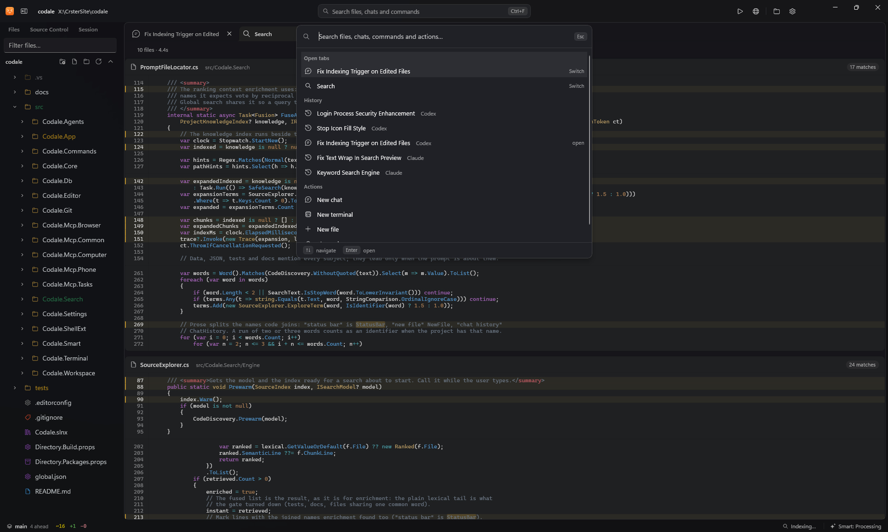
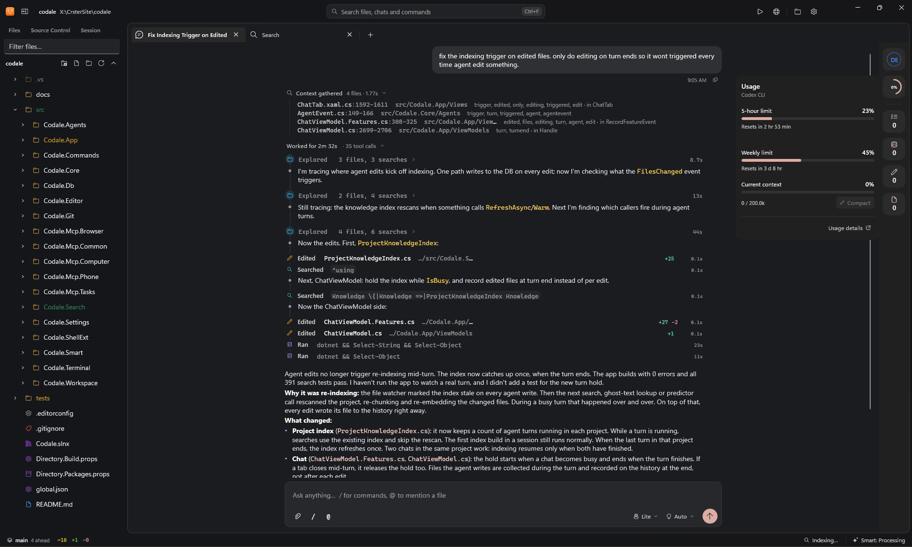
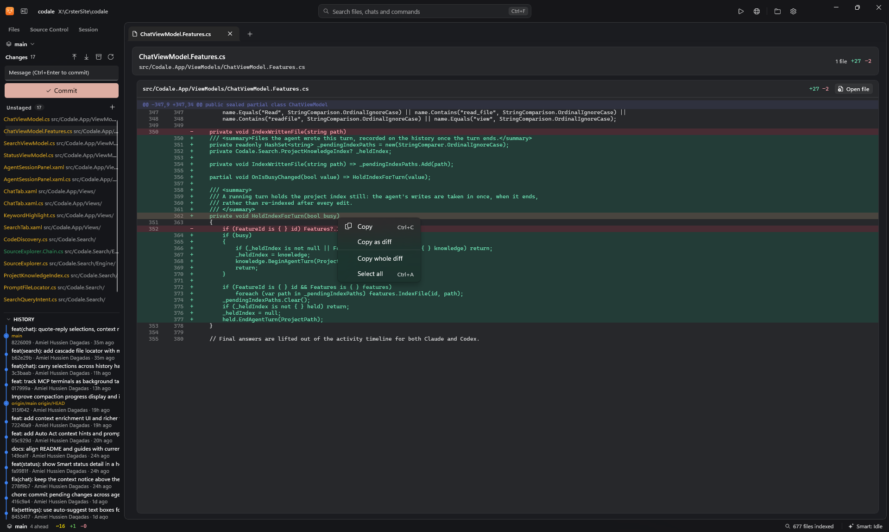

# Codale

**A Windows-native workbench for AI coding agents.**

Codale is a WinUI 3 desktop application targeting .NET 10 and Windows 11. It combines structured Claude and Codex conversations, a ConPTY terminal, Git tools, a source editor, project search, and MCP tools in a workspace window.



## Workbench

### Chat and accounts

- Claude and Codex sessions stream answers, reasoning, tool calls, approvals, plans, and usage into the chat view.
- Select an account or compatible endpoint profile, model, effort, and permission mode. Account profiles keep CLI credential homes separate; endpoint support depends on the selected agent and provider format.
- Auto mode assesses topic, question/action intent, difficulty, planning, clarity, and configuration/preferences through Decision, General, then local fallback. Topic changes offer another session, a new session, or retaining the message here.
- Questions use a Lite answer session; hard or unclear actions use a temporary Plus planner with a full requirements interview. Compact history entries open the answer or plan in the existing right-hand preview pane, where questions and follow-ups stay. Approving a plan sends it to the parent at its selected tier. Child history and pending plan reviews survive reopening.
- Project memory recalls relevant notes and captures user preferences, accepted decisions, and verified durable conventions. Claude, Codex, and terminal CLI integrations share the memory tools. Saved notes can be viewed or forgotten from chat.
- Open CLI transcript history, resume conversations, and hand off context between sessions. Responses show their model alongside their timestamp and copy action.
- Next-prompt suggestions use the active agent. Codex can fall back to an ephemeral read-only conversation when its prediction endpoint is unavailable. Suggestions can consume an additional model request.



### Terminals and project commands

- Open multiple terminal tabs backed by Windows ConPTY, with scrollback and a Win2D grid for interactive terminal programs.
- Choose PowerShell 7, Windows PowerShell, or Command Prompt. Automatic shell selection prefers PowerShell 7 when available.
- Launch saved or detected project commands from the commands menu. Commands run in terminal tabs where their output remains visible.
- Agents can read open terminals, run commands in new tabs, and interrupt terminals they opened through the terminal tools.
- Claude, Codex, Copilot, Gemini, Qwen, and OpenCode launch integration stages MCP configuration outside the repository. Other recognized CLIs, including Antigravity, Aider, Goose, and Cursor, can run in terminals; integration varies by CLI.
- Claude and Codex transcript readers supply native conversation history. Resuming other terminal CLIs depends on their supported launch arguments.

The former hosted background-task manager and its `start_task`, `read_task`, `list_tasks`, and `stop_task` tools have been removed. Use terminal tabs and the terminal MCP tools for running work.

### MCP tools

The `Codale.Mcp.Tasks` executable hosts five separate workspace servers, selected with `--server NAME`. Its project name is retained, but it no longer exposes a `codale-tasks` server.

| Server | Tools |
| --- | --- |
| `codale-panel` | `todos_set`, `artifact_add` for progress and deliverables |
| `codale-command` | `list_commands`, `add_command`, `run_command` for saved and detected commands |
| `codale-terminal` | `list_terminals`, `read_terminal`, `run_in_terminal`, `stop_terminal` |
| `codale-memory` | `memory_save`, `memory_search`, `memory_list`, `memory_forget` |
| `codale-todo` | `todo_list`, `todo_complete` for user-defined workspace todos |

`run_command` and `run_in_terminal` open visible terminal tabs. `stop_terminal` only interrupts terminals opened by the agent through those tools. The old MCP `explore` tool is no longer exposed.

Three additional executables supply optional tools:

- **`codale-browser`**: drives Codale Browser for navigation, snapshots, screenshots, interaction, uploads, viewport/emulation checks, and user handoff. Uploads are restricted to the project directory.

Codale Browser is the app's WebView2 window; the **Open browser** command opens it, and the browser MCP opens it on its first call if it is not running, then drives it over the DevTools Protocol on its loopback debugging port (9333). Each chat's agent works in a tab of its own, marked with that session's colour (a bar, tint and dot); tabs you open yourself stay plain, and a new agent tab opens in the background when you are on a page of your own. Agents ask for their tab over a per-user control pipe, so parallel chats never share a page. The toolbar has back, forward, reload (Shift+click for a hard reload that skips the cache), an address field, a **pick** button that copies a clicked element's path to the clipboard, a breakpoint preview, and the Console and Requests panels for recent page activity. Everything else, such as logins, permission prompts and downloads, is left to WebView2's own handling. Device and media emulation the agent sets lasts only while it is attached.

Each project has a persistent browser profile for its sign-ins and site data. **Open browser** selects that project's regular tabs. Choose **New Tab** from **+** to open a regular tab in the active project. Agent tabs for the same project share those sign-ins. Sign in once per project to start using its profile. To access sign-ins from the older shared profile, close Codale Browser and then launch it directly.

Choose **Private Tab** from **+** or press **Ctrl+Shift+P** to open a private tab. Each private tab has its own sign-ins and site data, so you can test several accounts on the same site at once. Closing a private tab discards its session. Links that request a new window from a private tab open in that same tab.
- **`codale-computer`**: Windows desktop screenshots and mouse/keyboard control.
- **`codale-phone`**: Android device and emulator control through `adb`, including screenshots, UI trees, input, deployment, logs, and port forwarding. Project file transfers are restricted to the project directory.

Tool availability and approvals depend on the selected tool and permission modes. Browser and desktop modes can also select supported agent-native integrations. Configure them from the agent tools controls.

### Smart features

Smart features use independently configured **General**, **Auto Complete**, **Embedding**, and **Decision** model roles. All roles start Off. General supports Claude/Codex CLI accounts and compatible API profiles; completion and embedding require supported OpenAI-compatible endpoints and explicit models.

Configured roles provide commit messages, shell translation, search refinement, summaries, completion, embeddings, and routing/risk decisions. Session names are generated locally. Local search and indexing remain available with Smart roles off. Remote features may send source code to the selected provider. Background provider exploration uses read tools.

The status bar shows Off, Idle, Suggesting, Processing, or Error. Hover over it for status details. The app no longer downloads, packages, or loads a local inference model. Native inference code remains for development and evaluation only.

See [Smart provider configuration and behavior](src/Codale.Smart/README.md) and [native development harness](src/Codale.Smart/native-runtime.md).

### Files, editor, search, and Git

- Browse project files and open text, diff, and Markdown previews. TextMate grammars provide syntax highlighting; missing grammars can be downloaded and cached.
- Configure editor typography, tabs, line numbers, and wrapping. Project identifiers support local suggestions; AI inline insertions require the Auto Complete role.
- Search uses a managed source index and `SourceExplorer`: local results appear first, followed by refinement when a provider is configured. Results include source excerpts and related files. The search panel no longer presents the old autonomous Ask answer loop; the retained `SearchAgentLoop` library is not its UI entry point.
- Workspace knowledge combines keyword and vector retrieval. With remote embedding off, the index uses a local hashed embedder.
- Git tools provide status, staging, commits, history, branch operations, synchronization, stashes, and diffs. Smart commit messages require a configured generation role.



## Configuration and storage

Open Settings to configure appearance, shortcuts, terminal/editor preferences, agent accounts, endpoint profiles, and Smart roles. The user-data folder button opens the active data location.

Preferences are stored in the application database under `%LOCALAPPDATA%\Codale\data\records`, subject to Windows package redirection for MSIX installs. Use the Settings window to edit preferences. Workspace stores and CLI transcripts have separate owners and lifetimes. Secrets use Windows protection and encrypted storage.

Example preference keys:

```json
{
  "app.theme": "Dark",
  "terminal.shell": "auto",
  "terminal.fontFamily": "Cascadia Mono",
  "terminal.fontSize": 13,
  "terminal.scrollback": 10000,
  "editor.fontSize": 13,
  "editor.tabWidth": 4,
  "editor.lineNumbers": true,
  "editor.highlighting": true,
  "editor.wordWrap": false,
  "chat.fontSize": 12.5,
  "ai.smart.groups.general.provider": "off",
  "ai.smart.groups.completion.provider": "off",
  "ai.smart.groups.embedding.provider": "off",
  "ai.smart.groups.decision.provider": "off"
}
```

Use Settings to create account and endpoint profiles and select agent defaults. The generated file contains the current keys; agent-specific defaults use `chat.defaults.<cli>.*`.

### Custom project commands

Open the commands menu and choose **Edit commands…** to add, change or remove saved commands in a
dialog: give one a name, choose whether it is a command line or a PowerShell, batch or shell script,
type the command or script, and optionally set its working directory. Saved commands live in the
workspace database (Codale's data folder, never in the project tree); scripts are written to a
`command-scripts` folder beside it, so they can be edited again from the same dialog. An old
`.codale/commands.json` in the project is ignored.

Command detectors also recognize Claude launch configuration, VS Code tasks/launch configuration, package scripts, .NET, Gradle, Maven, Python, Rust, Go, Composer/Laravel, Rails, Flutter, Elixir, Make, Just, Task, Docker Compose, Prisma, and root scripts. Discovery and saved-command access share `ProjectCommandService`; execution uses terminal tabs.

## Build and run

Requirements:

- Windows 11 with the Windows SDK needed by the app's `net10.0-windows10.0.26100.0` target.
- .NET SDK 10.0.401 or newer, selected by `global.json` with major-version roll-forward. Projects target .NET 10; the current verification used SDK 11.0.100.
- Visual Studio 2026 with Desktop development with C++ and the MSVC v145 toolset for the Explorer shell extension.
- Git for Git features; installed/authenticated agent CLIs for agent sessions. Browser tools use Codale Browser, which needs the WebView2 runtime; phone tools require Android SDK `adb` and a device or emulator.

From the repository root:

```powershell
dotnet build Codale.slnx -c Debug
dotnet run --project src/Codale.App/Codale.App.csproj
dotnet watch --project src/Codale.App/Codale.App.csproj --no-hot-reload
```

The solution maps the app to x64. App builds also build and bundle the MCP servers and native Explorer extension. The WinApp integration registers development package identity when launching. Close Codale if a build reports locked binaries.

Publish an unsigned release package from the app directory:

```powershell
cd src/Codale.App
dotnet publish -c Release -p:GenerateAppxPackageOnBuild=true -p:AppxPackageSigningEnabled=false
```

Release publishing uses ReadyToRun and retains reflection metadata with trimming disabled. The unsigned MSIX must be signed with a trusted certificate for installation/distribution. Development launch uses WinApp registration. Explorer's Open in Codale integration is supplied by the packaged C++ COM extension.

## Tests and verification

```powershell
dotnet build Codale.slnx -c Debug
dotnet test Codale.slnx -c Debug --no-build --no-restore
```

On November 16, 2026, merged `main` at `fa9981f` built with zero warnings/errors and passed all 2,372 tests across 12 test projects. This verifies the automated suite; interactive Windows flows, live agent requests, and native model inference were not exercised.

Live agent tests are opt-in and can consume tokens:

```powershell
$env:CODALE_LIVE_TESTS = "1"
dotnet test tests/Codale.Agents.Tests --filter "FullyQualifiedName~Live"
```

Routing corpus tests have their own opt-in switch, `CODALE_ROUTING_LIVE_TESTS=1`. Native inference smoke/evaluation commands are documented separately in the native harness notes.

`CODALE_SPECIALIST_LIVE_TESTS=1` enables `SpecialistSessionLiveTests`: real Claude/Codex answer and planner sessions against disposable fixtures. These checks spend tokens and require signed-in CLI accounts.

## Source layout and ownership

| Project | Responsibility |
| --- | --- |
| `Codale.App` | WinUI views/view models, composition, activation, packaging |
| `Codale.Core` | Domain models, policies, protocols, Markdown/syntax rules, terminal transport contracts |
| `Codale.Agents` | Claude/Codex sessions, transcripts, accounts, provider clients and Smart role routing |
| `Codale.Settings` | Settings, application persistence, recent projects, command history, shortcuts, syntax selection |
| `Codale.Workspace` | Workspace data contexts, database pool, memory/history/configuration/secrets |
| `Codale.Db` | Embedded storage, keyword/vector retrieval, graph, blobs, events, encryption |
| `Codale.Search` | Source indexing, discovery, search, knowledge retrieval |
| `Codale.Commands` | Focused command detectors, parsing, saved commands and run resolution |
| `Codale.Editor` / `Codale.Terminal` | Editor model / ConPTY session and terminal emulation |
| `Codale.Git` | Git CLI repository operations |
| `Codale.Smart` | Shared generation/exploration machinery and retained native development runtime |
| `Codale.Mcp.Tasks` | Five workspace MCP servers and terminal CLI pre-tool hook |
| `Codale.Mcp.Browser` / `.Computer` / `.Phone` | Browser, desktop, Android MCP hosts |
| `Codale.Mcp.Common` | Shared MCP protocol and workspace server definitions |
| `Codale.ShellExt` | Native Explorer COM extension |

`ApplicationServices` composes the application services and their shutdown. Workspaces receive explicit dependencies and own their workspace resources. Architecture tests pin project references and prohibit application service lookup and static database/settings fallbacks in application code. Standalone MCP processes retain their own storage boundaries. Core syntax/tokenization still includes process-wide services.

See the [source ownership inventory](docs/source-inventory.md) for implementation details and remaining manual checks. Codale is Windows-only; cross-platform shells are not implemented.
